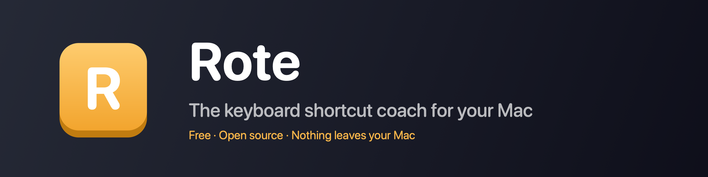

<p align="center">
  
</p>

<p align="center">
  <strong>The keyboard shortcut coach for your Mac</strong><br>
  Rote notices the menu items you keep clicking and teaches you their shortcuts, one keycap at a time. Hold ⌘ to see every shortcut of the app you are in.
</p>

<p align="center">
  <a href="https://github.com/beyondthecode-bc/Rote/releases/latest"></a>
  <a href="https://github.com/beyondthecode-bc/Rote/releases/latest"></a>
  <a href="https://github.com/beyondthecode-bc/Rote/stargazers"></a>
  
</p>

<p align="center">
  
  
  
  
  
</p>

<p align="center">
  <a href="https://github.com/sponsors/beyondthecode-bc"></a>
  <a href="https://www.buymeacoffee.com/BEYONDTHECODE"></a>
</p>

<p align="center">
  Built with Swift and SwiftUI. No Electron, no web views, no bloat. Open source under MIT.
</p>

---

## How it works

1. You pick a menu item with the mouse. Rote counts quietly.
2. The third time within a week, a keycap HUD shows the item's shortcut at the top of the screen, under the menu bar. It stays 2.5 seconds; move the pointer onto it to keep it there and reveal its Snooze menu.
3. Use the shortcut three times and Rote marks it learned and stops talking about it. If you drift back to the menu, five picks within a week bring the nudges back.
4. Hold ⌘ for a moment in any app and a full-screen sheet lists every shortcut it has, read live from its real menus. Items Rote is teaching you are tinted amber; learned ones carry a checkmark.

Rote is patient by design: at least four hours between nudges for the same item, ninety seconds between any two nudges, and at most twelve a day. The number of menu picks before a nudge, the hours between nudges for an item, the daily cap and how long the HUD stays are all settings.

Rote only coaches shortcuts it can see you use: ones with ⌘, ⌃ or ⌥, or an F-key. A plain key such as ⌫, or ⇧ with an arrow, looks exactly like typing, so Rote neither counts those presses nor coaches those items.

## Install

**Homebrew**

```bash
brew install --cask beyondthecode-bc/tap/rote
```

**Direct download**

Download `Rote-vX.Y.Z.zip` from [Releases](https://github.com/beyondthecode-bc/Rote/releases/latest), unzip, move `Rote.app` to Applications, and launch. A short onboarding explains what Rote does and asks for Accessibility access. Builds are Developer ID signed and notarized by Apple; every release lists its VirusTotal result and SHA-256.

**Updating**

Click the Rote menu bar icon → **About** → **Check Now** → **Download** → **Install and Relaunch**. macOS asks for an administrator password to replace the app. Homebrew users can run `brew upgrade --cask rote` instead. If the in-app update fails, quit Rote, download the zip from [Releases](https://github.com/beyondthecode-bc/Rote/releases/latest) and replace `/Applications/Rote.app` with the unzipped app.

## Permissions and privacy

Rote asks for one permission: **Accessibility**. It needs it to read app menus, to notice which menu item you picked and to recognise a shortcut when you press it. It never records what you type and has no analytics. Its only network requests go to GitHub: the update check against GitHub Releases (at launch, which you can turn off, and when you click Check Now) and the download of an update you ask for. Everything it remembers lives in `~/Library/Application Support/Rote/state.json` and in its preferences; Settings › Data can export the state as JSON or reset the statistics. See [PRIVACY.md](PRIVACY.md).

Rote cannot be sandboxed, because the Accessibility API is unavailable to sandboxed apps, so it is not on the Mac App Store.

## Features

- **Keycap HUD nudges** after repeated mouse use of a menu item. Its Snooze menu snoozes the item for a week, stops coaching it, or pauses Rote for an hour. With VoiceOver on, each nudge is announced, with the key names spoken in your language.
- **Shortcut sheet** for the frontmost app: hold ⌘, hold ⌥, or press ⌃⌥⌘K for a sheet that stays open until you press Esc or ⌃⌥⌘K again. Pick the trigger and the hold delay in Settings › Overlay, where you can also show items without a shortcut and the Apple menu.
- **Weekly progress** in the menu bar popover: tiles for shortcuts learned, menu clicks that had a shortcut, and shortcuts used, each showing its improvement on the week before, plus the items being coached now, grouped by app, and the ones you learned.
- **Pause** coaching for an hour, until tomorrow, or until you resume it. The pause survives quitting and relaunching Rote.
- **Per-app control:** a list of apps to never coach and a list of paused apps, in Settings › Apps. Items you stopped coaching can be coached again from Settings › Data.
- **Eight languages**: English, French, German, Spanish, Japanese, Korean, Portuguese (Brazil) and Chinese (Simplified), switchable live in Settings › General.
- Works in any app with a native menu bar, Electron apps included.
- Reduce Motion and Increase Contrast support, light and dark appearance, launch at login, in-app updates.

## Requirements

| | Requirement |
|---|---|
| macOS | 14 Sonoma or later |
| Chip | Apple Silicon or Intel |
| Permission | Accessibility |

## Building from source

Rote is built and tested with Xcode 27.1 (Swift 6.4) and [XcodeGen](https://github.com/yonaskolb/XcodeGen).

```bash
brew install xcodegen
git clone https://github.com/beyondthecode-bc/Rote.git && cd Rote
xcodegen generate
open Rote.xcodeproj
```

Run the checks CI runs:

```bash
python3 scripts/check-languages.py
swift test --package-path Packages/RoteCore
swift test --package-path Packages/RoteAX
xcodebuild test -project Rote.xcodeproj -scheme Rote -destination 'platform=macOS' \
  -derivedDataPath build/derived CODE_SIGN_IDENTITY="-"
xcodebuild build -project Rote.xcodeproj -scheme Rote -configuration Release -destination 'platform=macOS' \
  -derivedDataPath build/derived CODE_SIGN_IDENTITY="-"
```

Debug builds are signed ad hoc, so every rebuild looks like a new app to macOS and loses Accessibility access even while System Settings still shows Rote switched on. After a rebuild, remove Rote from System Settings › Privacy & Security › Accessibility and add the new build, or run `tccutil reset Accessibility com.beyondthecode.rote` and grant access again. See [CONTRIBUTING.md](CONTRIBUTING.md).

## Translations

Rote ships in English, French, German, Spanish, Japanese, Korean, Portuguese (Brazil) and Chinese (Simplified). Translations live in `languages/` as plain XML, including the key names VoiceOver speaks; corrections and new languages are welcome as pull requests. [CONTRIBUTING.md](CONTRIBUTING.md) explains the format.

## Troubleshooting

- **The menu bar icon is missing (macOS 27).** If you don’t see the keycap icon in the menu bar, macOS may have hidden it with other menu bar items. Click the button with two left-pointing arrows (“Show Hidden Menu Bar Items”) at the left end of the icons on the right side of the menu bar to reveal it.
- **No nudges appear.** Check System Settings › Privacy & Security › Accessibility: Rote must be enabled. If you replaced the app, remove the old entry and add the new one. Also check that coaching is not paused (the popover's header says so) and that the app is not in Settings › Apps.
- **The sheet does not appear when holding ⌘.** The hold is cancelled by any other key or a click, so hold ⌘ alone; the sheet also stays away while a menu is open. Check the trigger and the hold delay in Settings › Overlay.
- **An app shows few shortcuts.** Some apps fill in their menus only when you open them. Open the menus once, switch to another app and back after a minute, and hold ⌘ again.
- **Rebuilt from source and nothing works.** An ad-hoc signed build loses Accessibility access on every rebuild; see [Building from source](#building-from-source).

## Support

- [Open an issue](https://github.com/beyondthecode-bc/Rote/issues)
- [GitHub Sponsors](https://github.com/sponsors/beyondthecode-bc) · [Buy Me a Coffee](https://www.buymeacoffee.com/BEYONDTHECODE)
- apps@beyondthecode.app

## License

MIT. See [LICENSE](LICENSE).
